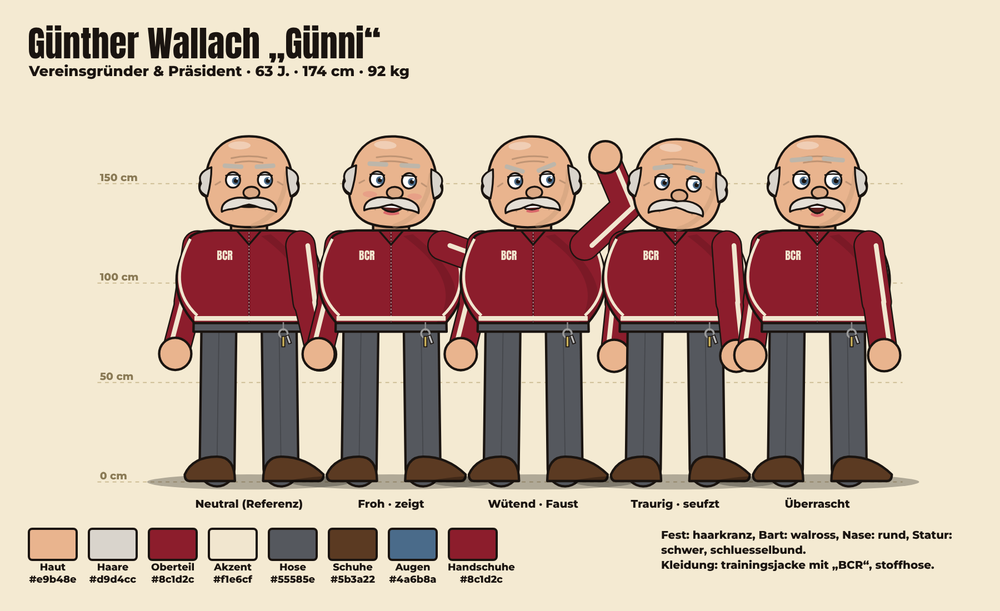
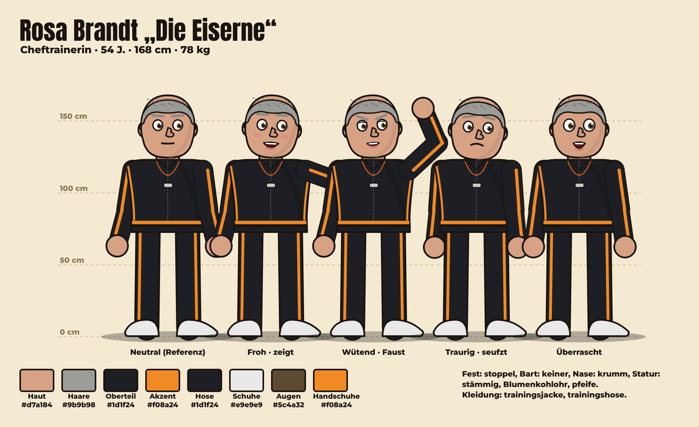
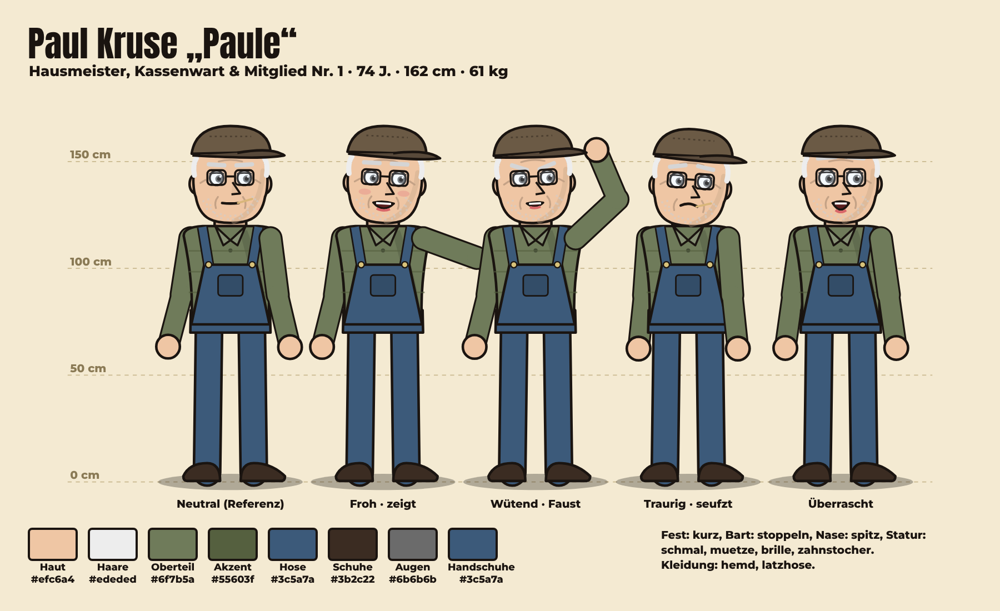
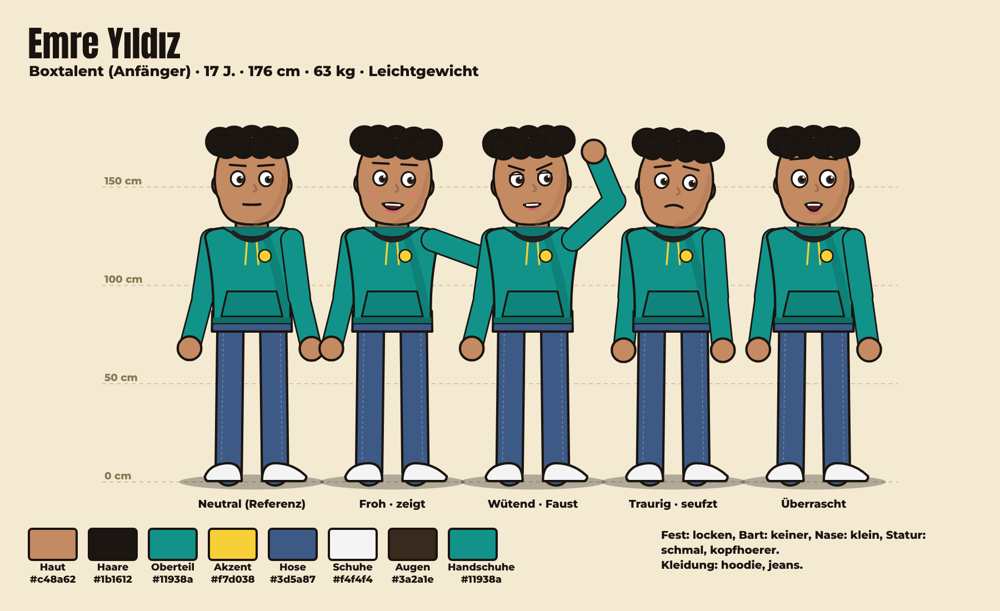
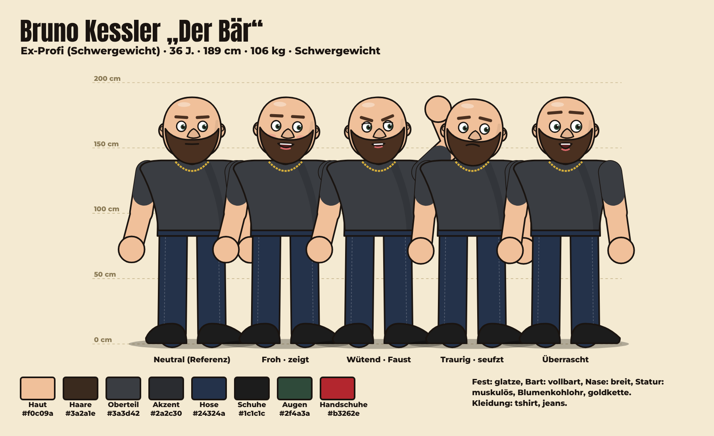
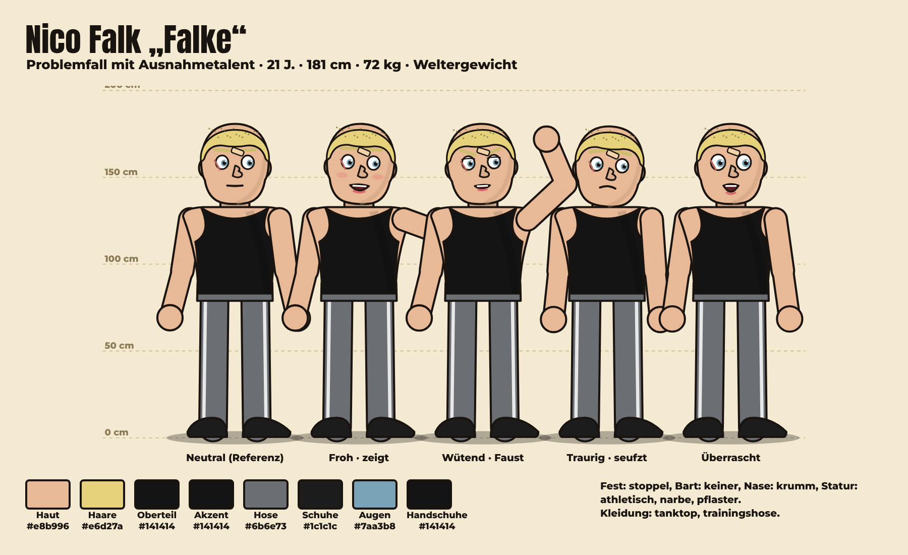
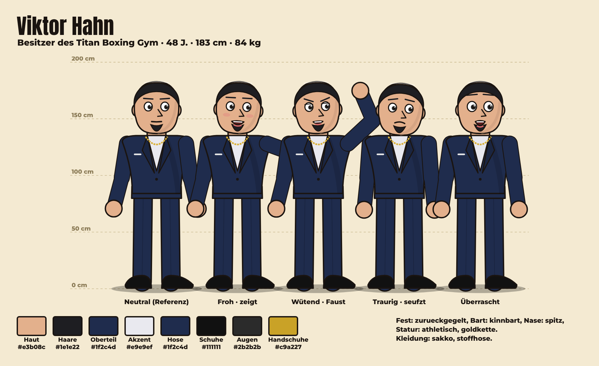

# CHARACTERS AND VOICES – Boxclub Rostfaust

Stand nach Folge 5 (2026-11-13). Quelle: `data/characters.json`. Referenzbilder: `docs/charakterbibel/`.

## Stimmen-Übersicht (verbindlich)
| Figur | Stimme | Anbieter / Modell | Voice-ID | Status | Hinweis |
|---|---|---|---|---|---|
| Günther Wallach | Reinhard (Inworld, deutsch) | inworld / inworld-tts-2 | `Reinhard` | 🔒 fest | Ab Folge 5: Reinhard (Inworld, deutsch) – Wechsel mit Zustimmung des Produzenten (13.11.2026), weil ElevenLabs über Speko erst nach einer Aufladung nutzbar ist. Bis Folge 4: Thomas – Authentic & Natural. Ohne Regie-Tags. |
| Rosa Brandt | Katerina (Alibaba Qwen3) – ab Folge 5, vom Produzenten per Hörprobe gewählt | alibaba / qwen3-tts-flash | `Katerina` | 🔒 fest | Ab Folge 5: Katerina (Alibaba qwen3-tts-flash), gewählt vom Produzenten aus 4 Hörproben (13.11.2026). Ohne Regie-Tags. Folge 4: Inworld Annika. |
| Paul Kruse | Henrik (Speechify, deutsch) | speechify / simba-3.5 | `henrik-agent` | 🔒 fest | Ab Folge 5: Henrik (Speechify, deutsch) – Wechsel mit Zustimmung des Produzenten (13.11.2026), weil ElevenLabs über Speko erst nach einer Aufladung nutzbar ist. Bis Folge 4: Roman – Friendly & Approachable. Ohne Regie-Tags. |
| Emre Yıldız | Klaus (Microsoft MAI-Voice, deutsch) | azure / MAI-Voice-2.1 | `de-DE-Klaus:MAI-Voice-2.1` | 🔒 fest | Ab Folge 5: Klaus (Microsoft MAI-Voice, deutsch) – Wechsel mit Zustimmung des Produzenten (13.11.2026), weil ElevenLabs über Speko erst nach einer Aufladung nutzbar ist. Bis Folge 4: Liam – Energetic. Ohne Regie-Tags. |
| Bruno Kessler | Brian – Deep | elevenlabs / eleven_v3 | `nPczCjzI2devNBz1zQrb` | Vorschlag | Vorschlag: ElevenLabs „Brian – Deep“. Noch nicht gesprochen. |
| Nico Falk | Callum – Husky | elevenlabs / eleven_v3 | `N2lVS1w4EtoT3dr4eOWO` | Vorschlag | Vorschlag: ElevenLabs „Callum – Husky“. Noch nicht gesprochen. |
| Viktor Hahn | Eric – Smooth | elevenlabs / eleven_v3 | `cjVigY5qzO86Huf0OWal` | Vorschlag | Vorschlag: ElevenLabs „Eric – Smooth“. Noch nicht gesprochen. |

**Regel:** Stimmen mit 🔒 werden nie ohne ausdrückliche Zustimmung des Produzenten geändert. Prüfung jeder Zeile: Grundtonhöhe (`scripts/pitch.py`) + Spracherkennung.

## Günther Wallach „Günni“

- **Rolle:** Vereinsgründer & Präsident · **Status:** aktiv (seit Folge 1)
- **Daten:** 63 J., 174 cm, 92 kg 
- **Aussehen (fest):** Haut #e9b48e, Haare haarkranz #d9d4cc, Bart walross, Nase rund, Statur schwer; trainingsjacke #8c1d2c/#f1e6cf „BCR“, stoffhose #55585e, Schuhe #5b3a22; Accessoires: schluesselbund
- **Persönlichkeit:** Unverbesserlicher Optimist und Träumer. Redet groß, rechnet schlecht, gibt nie auf. Hat ein riesiges Herz und keinen Plan B.
- **Sprechstil:** Laut, begeistert, Ruhrpott-Einschlag („Dat wird!“), viele Ausrufezeichen, redet direkt in die Kamera.
- **Stärken/Schwächen:** Begeisterung, kennt halb Kranstadt, gibt niemals auf / Finanzen, verspricht zu viel, unterschätzt Probleme
- **Ziel:** Den Boxclub Rostfaust wieder zum größten Verein der Stadt machen – wie zu Vaters Zeiten. · **Spruch:** „Dat wird ganz groß!“
- **Hintergrund:** Ehemaliger Kranführer im Kranstädter Hafen. Sein Vater gründete 1961 den Boxclub Rostfaust, der 2009 schloss. Mit seiner Abfindung hat Günther die alte Depothalle zurückgepachtet, um den Club wiederzubeleben.

## Rosa Brandt „Die Eiserne“

- **Rolle:** Cheftrainerin · **Status:** aktiv (seit Folge 1)
- **Daten:** 54 J., 168 cm, 78 kg 
- **Aussehen (fest):** Haut #d7a184, Haare stoppel #9b9b98, Bart keiner, Nase krumm, Statur stämmig, Blumenkohlohr; trainingsjacke #1d1f24/#f08a24, trainingshose #1d1f24, Schuhe #e9e9e9; Accessoires: pfeife
- **Persönlichkeit:** Streng, wortkarg, absolut fair. Lobt selten – wenn doch, bedeutet es alles. Duldet keine Ausreden, schützt ihre Boxer aber wie eine Löwin.
- **Sprechstil:** Kurze Sätze. Trocken. Oft nur ein Wort („Nochmal.“). Nie laut – muss sie auch nicht.
- **Stärken/Schwächen:** Technik, Erfahrung, erkennt Talent sofort / ungeduldig mit Faulheit, stur, schlecht im Verkaufen
- **Ziel:** Einen Boxer bis zur Deutschen Meisterschaft bringen – auf ihre Art. · **Spruch:** „Nochmal.“
- **Hintergrund:** EM-Bronze 1994 im Amateurboxen. Danach 20 Jahre Trainerin im großen Titan-Gym, bis sie gefeuert wurde, weil sie einen verletzten Boxer nicht in den Ring schicken wollte. Günther ist der Einzige, der sie danach angerufen hat.

## Paul Kruse „Paule“

- **Rolle:** Hausmeister, Kassenwart & Mitglied Nr. 1 · **Status:** aktiv (seit Folge 1)
- **Daten:** 74 J., 162 cm, 61 kg 
- **Aussehen (fest):** Haut #efc6a4, Haare kurz #ededed, Bart stoppeln, Nase spitz, Statur schmal; hemd #6f7b5a/#55603f, latzhose #3c5a7a, Schuhe #3b2c22; Accessoires: muetze, brille, zahnstocher
- **Persönlichkeit:** Trocken, sarkastisch, unerschütterlich. Weiß alles über jeden in Kranstadt. Bremst Günthers Fantasien mit Zahlen.
- **Sprechstil:** Lakonisch, langsam, Pointe am Satzende. Spricht Günther mit „Günni“ an.
- **Stärken/Schwächen:** Gedächtnis, kann alles reparieren, Zahlen / Rücken, Pessimismus, erzählt nicht alles, was er weiß
- **Ziel:** Dass die Halle nicht abgerissen wird, solange er lebt. · **Spruch:** „Hab ich schon mal erlebt.“
- **Hintergrund:** Seit 1979 Hausmeister der Depothalle. Hat die Schlüssel nie abgegeben – auch nicht, als der Club 2009 schloss. Führt die Kasse in einem karierten Schulheft.

## Emre Yıldız

- **Rolle:** Boxtalent (Anfänger) · **Status:** aktiv (seit Folge 1)
- **Daten:** 17 J., 176 cm, 63 kg Leichtgewicht · Bilanz 0–0–0
- **Aussehen (fest):** Haut #c48a62, Haare locken #1b1612, Bart keiner, Nase klein, Statur schmal; hoodie #11938a/#f7d038, jeans #3d5a87, Schuhe #f4f4f4; Accessoires: kopfhoerer
- **Persönlichkeit:** Frech, schnell, ungeduldig, extrem ehrgeizig. Hinter der großen Klappe steckt Angst, seine Familie zu enttäuschen.
- **Sprechstil:** Schnell, Jugendsprache, selbstbewusst („Safe, Bruder“), übertreibt gern.
- **Stärken/Schwächen:** Hand- und Fußschnelligkeit, Reflexe, Hunger / null Technik, Kondition, Ungeduld
- **Ziel:** Profiboxer werden und seiner Mutter eine Wohnung kaufen. · **Spruch:** „Ich bin schneller als dein Gedanke.“
- **Hintergrund:** Fährt nach der Schule Essen aus, um seiner Mutter mit der Miete zu helfen. Hat nie trainiert, aber Straßenreflexe wie eine Katze. Sein Vorbild ist Muhammad Ali – er kennt jedes Video.

## Bruno Kessler „Der Bär“

- **Rolle:** Ex-Profi (Schwergewicht) · **Status:** kandidat (seit Folge 1)
- **Daten:** 36 J., 189 cm, 106 kg Schwergewicht · Bilanz 14–3–0
- **Aussehen (fest):** Haut #f0c09a, Haare glatze #3a2a1e, Bart vollbart, Nase breit, Statur muskulös, Blumenkohlohr; tshirt #3a3d42/#2a2c30, jeans #24324a, Schuhe #1c1c1c; Accessoires: goldkette
- **Persönlichkeit:** Ruhig, gutmütig, schwermütig. Schämt sich für seinen Absturz. Wenn er lacht, lacht die ganze Halle mit.
- **Sprechstil:** Tiefe Stimme, langsam, wenige Worte, leicht melancholisch.
- **Stärken/Schwächen:** Schlagkraft, Erfahrung, Ringintelligenz / Knie, Selbstzweifel, alte Schulden
- **Ziel:** Ein letzter Kampf, auf den er stolz sein kann. · **Spruch:** „Einmal noch.“
- **Hintergrund:** Profibilanz 14–3. Nach einer Knieverletzung und schlechten Managern stand er mit nichts da. Arbeitet heute als Türsteher. Paule kennt eine Geschichte über ihn, die er (noch) nicht erzählt.

## Nico Falk „Falke“

- **Rolle:** Problemfall mit Ausnahmetalent · **Status:** kandidat
- **Daten:** 21 J., 181 cm, 72 kg Weltergewicht · Bilanz 0–0–0
- **Aussehen (fest):** Haut #e8b996, Haare stoppel #e6d27a, Bart keiner, Nase krumm, Statur athletisch; tanktop #141414/#141414, trainingshose #6b6e73, Schuhe #1c1c1c; Accessoires: narbe, pflaster
- **Persönlichkeit:** Hochbegabt, misstrauisch, impulsiv. Testet jede Grenze. Loyal bis zur Selbstaufgabe, wenn man ihm einmal vertraut.
- **Sprechstil:** Knapp, provokant, ironisch. Antwortet gern mit Gegenfragen.
- **Stärken/Schwächen:** Instinkt, Timing, Härte / Disziplin, Jähzorn, Vergangenheit
- **Ziel:** Beweisen, dass er mehr ist als seine Akte. · **Spruch:** „Und jetzt?“
- **Hintergrund:** Zwei Jahre Jugendhaft wegen einer Schlägerei, die er bis heute anders erzählt. Hat im Knast boxen gelernt. Niemand will ihm eine Chance geben.

## Viktor Hahn

- **Rolle:** Besitzer des Titan Boxing Gym · **Status:** gast
- **Daten:** 48 J., 183 cm, 84 kg 
- **Aussehen (fest):** Haut #e3b08c, Haare zurueckgegelt #1e1e22, Bart kinnbart, Nase spitz, Statur athletisch; sakko #1f2c4d/#e9e9ef, stoffhose #1f2c4d, Schuhe #111111; Accessoires: goldkette
- **Persönlichkeit:** Glatt, charmant, berechnend. Sieht Boxen als Geschäft. Will die Depothalle für ein neues Fitnessstudio.
- **Sprechstil:** Höflich, gönnerhaft, Business-Sprache („Synergien“, „Marke“).
- **Stärken/Schwächen:** Geld, Kontakte, Marketing / Arroganz, unterschätzt Herz
- **Ziel:** Den Rostfaust-Club schlucken oder plattmachen. · **Spruch:** „Nichts Persönliches, Günther. Nur Business.“
- **Hintergrund:** Besitzt das moderne Titan Boxing Gym in der Innenstadt mit 600 Mitgliedern. Hat Rosa gefeuert. Kennt Günther aus der Schulzeit – und hat ihn schon damals unterschätzt.

