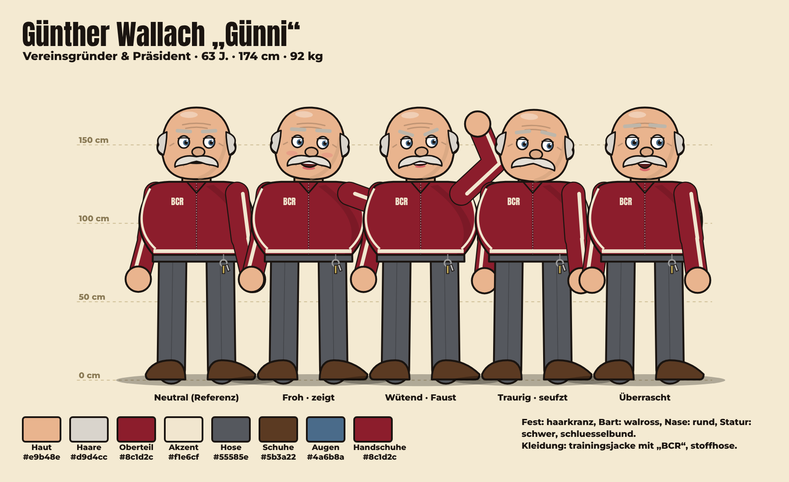
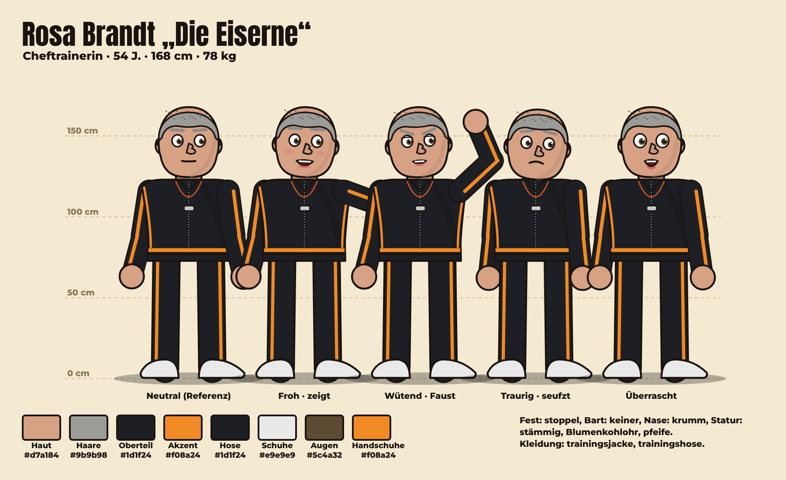
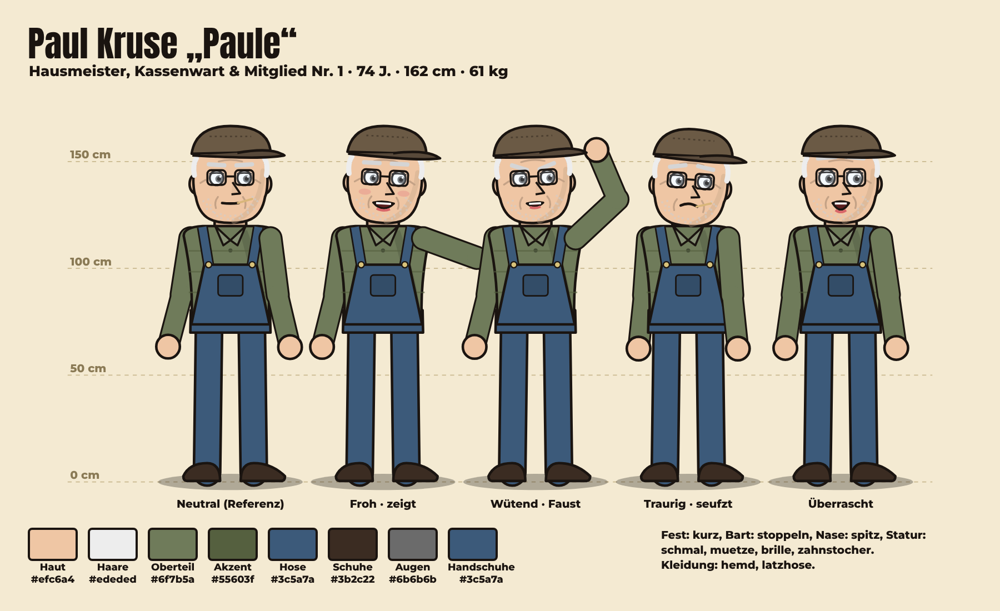
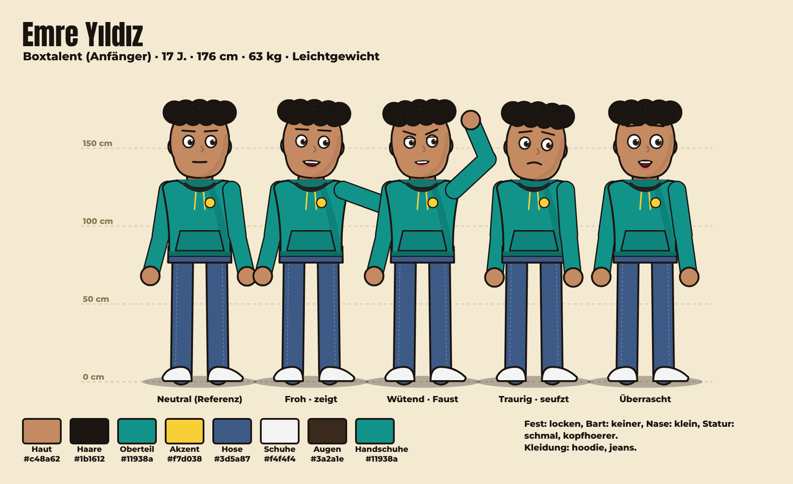
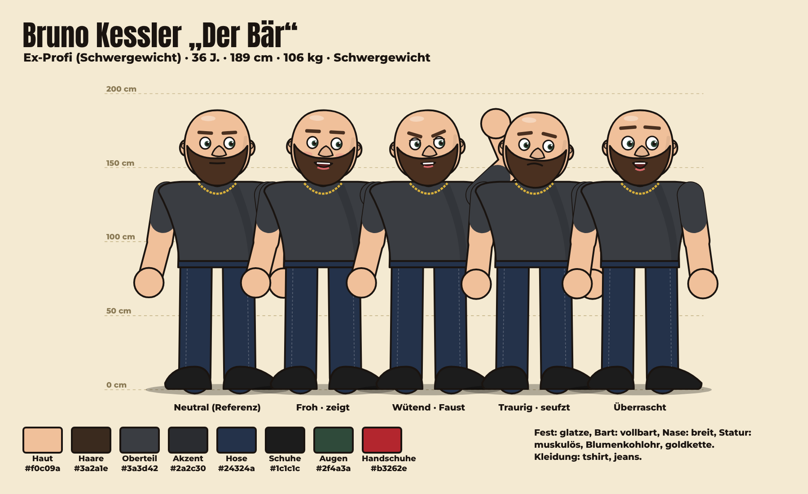
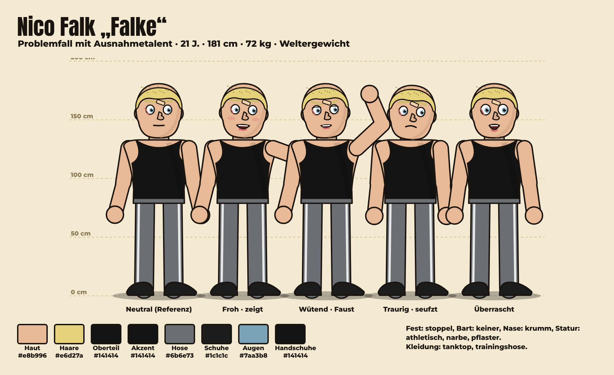
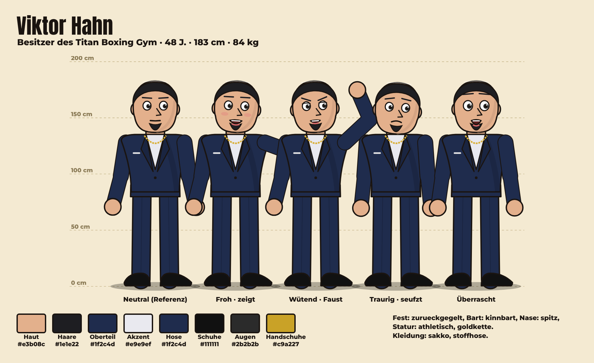

# Charakterbibel – BOXCLUB

Automatisch erzeugt aus `data/characters.json` (2026-11-09).
Die Bilder werden aus denselben Daten gezeichnet wie die Animation – sie sind die verbindliche Referenz.

## Günther Wallach „Günni“

| | |
|---|---|
| Rolle | Vereinsgründer & Präsident (gruender) |
| Status | aktiv |
| Alter / Größe / Gewicht | 63 J. · 174 cm · 92 kg  |
| Persönlichkeit | Unverbesserlicher Optimist und Träumer. Redet groß, rechnet schlecht, gibt nie auf. Hat ein riesiges Herz und keinen Plan B. |
| Hintergrund | Ehemaliger Kranführer im Kranstädter Hafen. Sein Vater gründete 1961 den Boxclub Rostfaust, der 2009 schloss. Mit seiner Abfindung hat Günther die alte Depothalle zurückgepachtet, um den Club wiederzubeleben. |
| Sprechstil | Laut, begeistert, Ruhrpott-Einschlag („Dat wird!“), viele Ausrufezeichen, redet direkt in die Kamera. |
| Stärken | Begeisterung, kennt halb Kranstadt, gibt niemals auf |
| Schwächen | Finanzen, verspricht zu viel, unterschätzt Probleme |
| Ziel | Den Boxclub Rostfaust wieder zum größten Verein der Stadt machen – wie zu Vaters Zeiten. |
| Spruch | „Dat wird ganz groß!“ |
| Bilanz | 0–0–0 |
| Kleidung | trainingsjacke #8c1d2c/#f1e6cf „BCR“, stoffhose #55585e, Schuhe #5b3a22 |
| Kopf | Haut #e9b48e, Haare haarkranz #d9d4cc, Bart walross, Nase rund, Augen #4a6b8a |
| Accessoires | schluesselbund |
| Stimme | ElevenLabs `5faieqDE3osz75KiOI2M` · OpenAI `ash` |

## Rosa Brandt „Die Eiserne“

| | |
|---|---|
| Rolle | Cheftrainerin (trainer) |
| Status | aktiv |
| Alter / Größe / Gewicht | 54 J. · 168 cm · 78 kg  |
| Persönlichkeit | Streng, wortkarg, absolut fair. Lobt selten – wenn doch, bedeutet es alles. Duldet keine Ausreden, schützt ihre Boxer aber wie eine Löwin. |
| Hintergrund | EM-Bronze 1994 im Amateurboxen. Danach 20 Jahre Trainerin im großen Titan-Gym, bis sie gefeuert wurde, weil sie einen verletzten Boxer nicht in den Ring schicken wollte. Günther ist der Einzige, der sie danach angerufen hat. |
| Sprechstil | Kurze Sätze. Trocken. Oft nur ein Wort („Nochmal.“). Nie laut – muss sie auch nicht. |
| Stärken | Technik, Erfahrung, erkennt Talent sofort |
| Schwächen | ungeduldig mit Faulheit, stur, schlecht im Verkaufen |
| Ziel | Einen Boxer bis zur Deutschen Meisterschaft bringen – auf ihre Art. |
| Spruch | „Nochmal.“ |
| Bilanz | 0–0–0 |
| Kleidung | trainingsjacke #1d1f24/#f08a24, trainingshose #1d1f24, Schuhe #e9e9e9 |
| Kopf | Haut #d7a184, Haare stoppel #9b9b98, Bart keiner, Nase krumm, Augen #5c4a32, Blumenkohlohr |
| Accessoires | pfeife |
| Stimme | ElevenLabs `le3O97c6UClnRdpxkDTb` · OpenAI `sage` |

## Paul Kruse „Paule“

| | |
|---|---|
| Rolle | Hausmeister, Kassenwart & Mitglied Nr. 1 (mitarbeiter) |
| Status | aktiv |
| Alter / Größe / Gewicht | 74 J. · 162 cm · 61 kg  |
| Persönlichkeit | Trocken, sarkastisch, unerschütterlich. Weiß alles über jeden in Kranstadt. Bremst Günthers Fantasien mit Zahlen. |
| Hintergrund | Seit 1979 Hausmeister der Depothalle. Hat die Schlüssel nie abgegeben – auch nicht, als der Club 2009 schloss. Führt die Kasse in einem karierten Schulheft. |
| Sprechstil | Lakonisch, langsam, Pointe am Satzende. Spricht Günther mit „Günni“ an. |
| Stärken | Gedächtnis, kann alles reparieren, Zahlen |
| Schwächen | Rücken, Pessimismus, erzählt nicht alles, was er weiß |
| Ziel | Dass die Halle nicht abgerissen wird, solange er lebt. |
| Spruch | „Hab ich schon mal erlebt.“ |
| Bilanz | 0–0–0 |
| Kleidung | hemd #6f7b5a/#55603f, latzhose #3c5a7a, Schuhe #3b2c22 |
| Kopf | Haut #efc6a4, Haare kurz #ededed, Bart stoppeln, Nase spitz, Augen #6b6b6b |
| Accessoires | muetze, brille, zahnstocher |
| Stimme | ElevenLabs `6i9HBATmN8DhZRFTlPOK` · OpenAI `echo` |

## Emre Yıldız

| | |
|---|---|
| Rolle | Boxtalent (Anfänger) (boxer) |
| Status | kandidat |
| Alter / Größe / Gewicht | 17 J. · 176 cm · 63 kg Leichtgewicht |
| Persönlichkeit | Frech, schnell, ungeduldig, extrem ehrgeizig. Hinter der großen Klappe steckt Angst, seine Familie zu enttäuschen. |
| Hintergrund | Fährt nach der Schule Essen aus, um seiner Mutter mit der Miete zu helfen. Hat nie trainiert, aber Straßenreflexe wie eine Katze. Sein Vorbild ist Muhammad Ali – er kennt jedes Video. |
| Sprechstil | Schnell, Jugendsprache, selbstbewusst („Safe, Bruder“), übertreibt gern. |
| Stärken | Hand- und Fußschnelligkeit, Reflexe, Hunger |
| Schwächen | null Technik, Kondition, Ungeduld |
| Ziel | Profiboxer werden und seiner Mutter eine Wohnung kaufen. |
| Spruch | „Ich bin schneller als dein Gedanke.“ |
| Bilanz | 0–0–0 |
| Kleidung | hoodie #11938a/#f7d038, jeans #3d5a87, Schuhe #f4f4f4 |
| Kopf | Haut #c48a62, Haare locken #1b1612, Bart keiner, Nase klein, Augen #3a2a1e |
| Accessoires | kopfhoerer |
| Stimme | ElevenLabs `1YST1S3BrkT7E0wcLKQD` · OpenAI `verse` |

## Bruno Kessler „Der Bär“

| | |
|---|---|
| Rolle | Ex-Profi (Schwergewicht) (boxer) |
| Status | kandidat |
| Alter / Größe / Gewicht | 36 J. · 189 cm · 106 kg Schwergewicht |
| Persönlichkeit | Ruhig, gutmütig, schwermütig. Schämt sich für seinen Absturz. Wenn er lacht, lacht die ganze Halle mit. |
| Hintergrund | Profibilanz 14–3. Nach einer Knieverletzung und schlechten Managern stand er mit nichts da. Arbeitet heute als Türsteher. Paule kennt eine Geschichte über ihn, die er (noch) nicht erzählt. |
| Sprechstil | Tiefe Stimme, langsam, wenige Worte, leicht melancholisch. |
| Stärken | Schlagkraft, Erfahrung, Ringintelligenz |
| Schwächen | Knie, Selbstzweifel, alte Schulden |
| Ziel | Ein letzter Kampf, auf den er stolz sein kann. |
| Spruch | „Einmal noch.“ |
| Bilanz | 14–3–0 |
| Kleidung | tshirt #3a3d42/#2a2c30, jeans #24324a, Schuhe #1c1c1c |
| Kopf | Haut #f0c09a, Haare glatze #3a2a1e, Bart vollbart, Nase breit, Augen #2f4a3a, Blumenkohlohr |
| Accessoires | goldkette |
| Stimme | ElevenLabs `nPczCjzI2devNBz1zQrb` · OpenAI `onyx` |

## Nico Falk „Falke“

| | |
|---|---|
| Rolle | Problemfall mit Ausnahmetalent (boxer) |
| Status | kandidat |
| Alter / Größe / Gewicht | 21 J. · 181 cm · 72 kg Weltergewicht |
| Persönlichkeit | Hochbegabt, misstrauisch, impulsiv. Testet jede Grenze. Loyal bis zur Selbstaufgabe, wenn man ihm einmal vertraut. |
| Hintergrund | Zwei Jahre Jugendhaft wegen einer Schlägerei, die er bis heute anders erzählt. Hat im Knast boxen gelernt. Niemand will ihm eine Chance geben. |
| Sprechstil | Knapp, provokant, ironisch. Antwortet gern mit Gegenfragen. |
| Stärken | Instinkt, Timing, Härte |
| Schwächen | Disziplin, Jähzorn, Vergangenheit |
| Ziel | Beweisen, dass er mehr ist als seine Akte. |
| Spruch | „Und jetzt?“ |
| Bilanz | 0–0–0 |
| Kleidung | tanktop #141414/#141414, trainingshose #6b6e73, Schuhe #1c1c1c |
| Kopf | Haut #e8b996, Haare stoppel #e6d27a, Bart keiner, Nase krumm, Augen #7aa3b8 |
| Accessoires | narbe, pflaster |
| Stimme | ElevenLabs `N2lVS1w4EtoT3dr4eOWO` · OpenAI `ballad` |

## Viktor Hahn

| | |
|---|---|
| Rolle | Besitzer des Titan Boxing Gym (rivale) |
| Status | gast |
| Alter / Größe / Gewicht | 48 J. · 183 cm · 84 kg  |
| Persönlichkeit | Glatt, charmant, berechnend. Sieht Boxen als Geschäft. Will die Depothalle für ein neues Fitnessstudio. |
| Hintergrund | Besitzt das moderne Titan Boxing Gym in der Innenstadt mit 600 Mitgliedern. Hat Rosa gefeuert. Kennt Günther aus der Schulzeit – und hat ihn schon damals unterschätzt. |
| Sprechstil | Höflich, gönnerhaft, Business-Sprache („Synergien“, „Marke“). |
| Stärken | Geld, Kontakte, Marketing |
| Schwächen | Arroganz, unterschätzt Herz |
| Ziel | Den Rostfaust-Club schlucken oder plattmachen. |
| Spruch | „Nichts Persönliches, Günther. Nur Business.“ |
| Bilanz | 0–0–0 |
| Kleidung | sakko #1f2c4d/#e9e9ef, stoffhose #1f2c4d, Schuhe #111111 |
| Kopf | Haut #e3b08c, Haare zurueckgegelt #1e1e22, Bart kinnbart, Nase spitz, Augen #2b2b2b |
| Accessoires | goldkette |
| Stimme | ElevenLabs `cjVigY5qzO86Huf0OWal` · OpenAI `alloy` |

